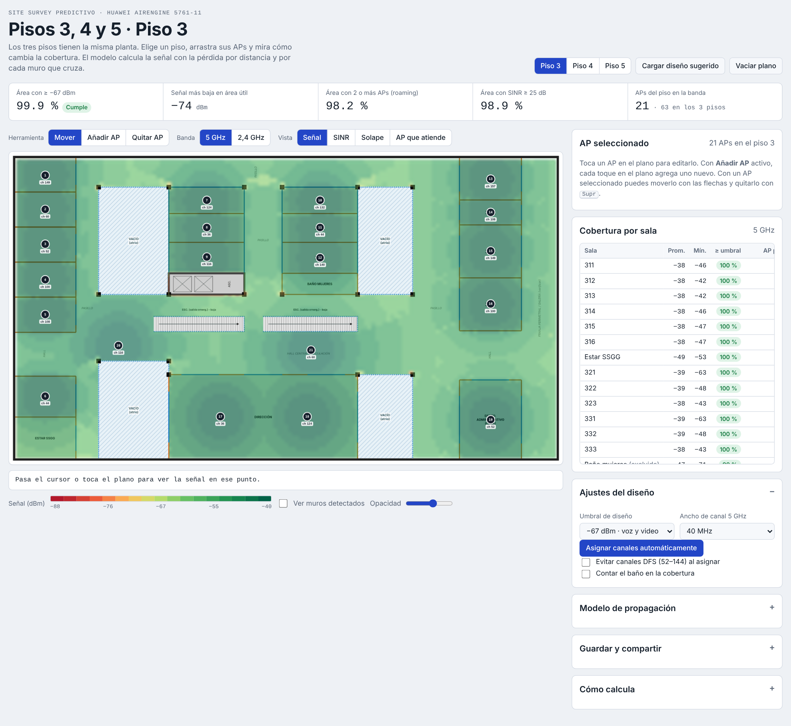

# Site survey · Pisos 3, 4 y 5 · Duoc UC Viña del Mar

Herramienta interactiva de site survey predictivo usada en el proyecto semestral de **TRY1101 Tecnología de Redes Inalámbricas** (Duoc UC, Ingeniería en Conectividad y Redes).

Simula la cobertura WiFi de los pisos 3, 4 y 5 con 21 APs Huawei AirEngine 5761-11 por piso (63 en total), en 2,4 GHz y 5 GHz:

- Mapa de señal (dBm), SINR, solape de APs (roaming) y AP que atiende cada punto.
- Indicadores por piso: área con señal ≥ −67 dBm, señal mínima, área con roaming y área con SINR ≥ 25 dB.
- Resultados por sala.
- Edición de APs (mover, añadir, quitar, canal y potencia), asignación automática de canales y exportación a JSON o Excel.

**Demo en línea:** https://sonpepe.github.io/site-survey-duoc-vina/



## Resultados del diseño sugerido (cada piso)

| Indicador | 5 GHz | 2,4 GHz |
|---|---|---|
| Área con ≥ −67 dBm | **99,9 %** | 99,6 % |
| Señal más baja en el área útil | −74 dBm | −74 dBm |
| Área con 2 o más APs (roaming) | 98,2 % | 87,9 % |
| Área con SINR ≥ 25 dB | 98,9 % | 63,4 % |
| APs con radio activa | 21 | 6 |

> La señal se calcula con pérdida por distancia y por muro. Es una predicción de diseño y se valida midiendo en terreno después de instalar.

## Documentación

| Documento | Contenido |
|---|---|
| [Metodología](docs/METODOLOGIA.md) | Criterios, supuestos, pasos, modelo de propagación, resultados y limitaciones |
| [Ficha técnica del AP](docs/AP_HUAWEI_AIRENGINE_5761-11.md) | Especificaciones del Huawei AirEngine 5761-11, enlace al datasheet oficial y cómo se usan en el modelo |
| [Explicación del código](docs/CODIGO.md) | Estructura del HTML, cálculo de señal, dibujo, interacción y asignación de canales |
| [Capturas](docs/capturas/) | Señal, SINR, solape, AP que atiende, 2,4 GHz, muros, piso 4, indicadores y tabla por sala |

## Estructura del repositorio

```
index.html                 ← la herramienta (archivo único, se publica en GitHub Pages)
src/
├── template.html          ← código legible (HTML + CSS + JS) sin los datos base64
├── build.py               ← regenera index.html
└── assets/                ← plano de la planta tipo y grilla de muros
docs/
├── METODOLOGIA.md
├── AP_HUAWEI_AIRENGINE_5761-11.md
├── CODIGO.md
└── capturas/
```

Para modificar la herramienta, edita `src/template.html` y ejecuta:

```bash
python3 src/build.py
```

Autor: José Rodríguez Smith · 2026
