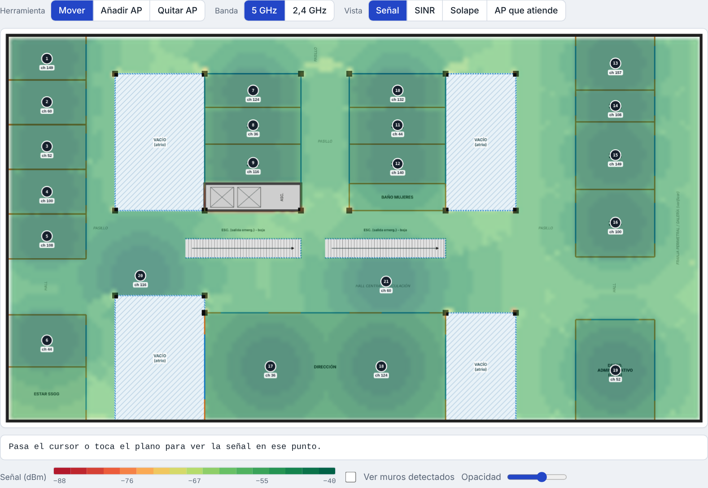
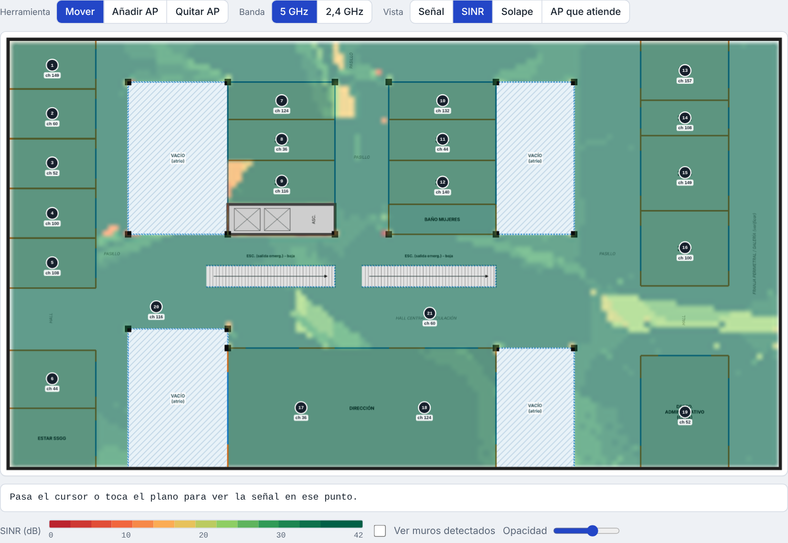
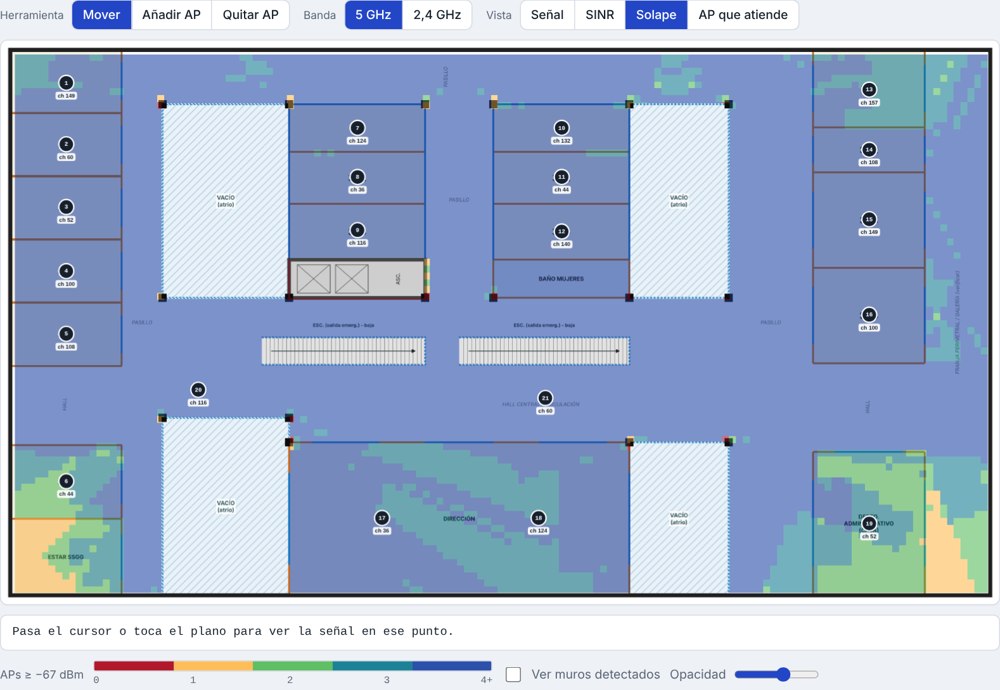
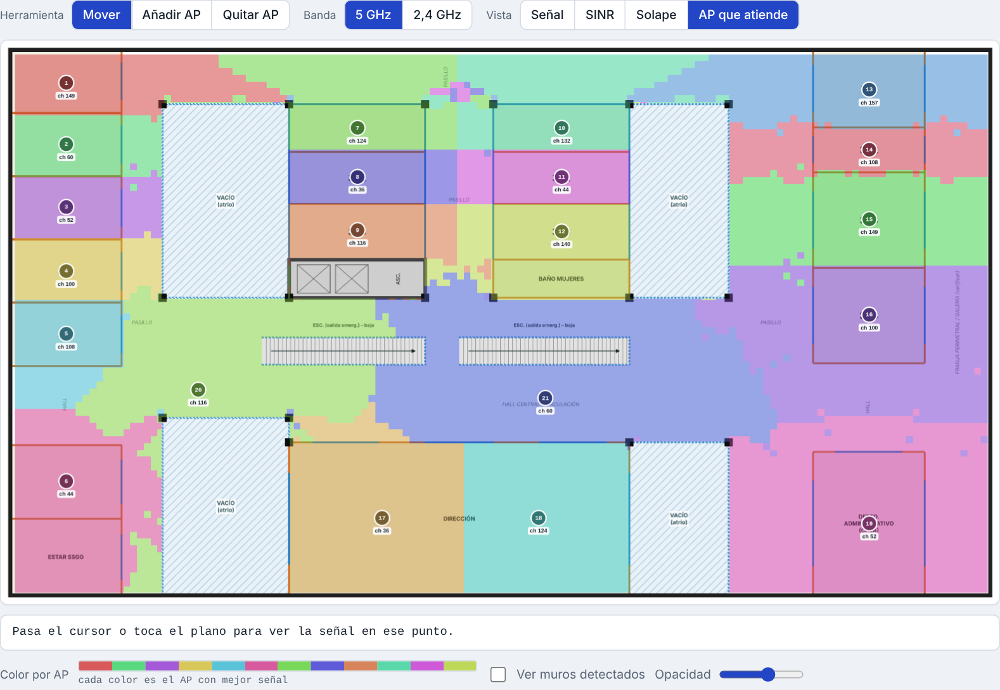
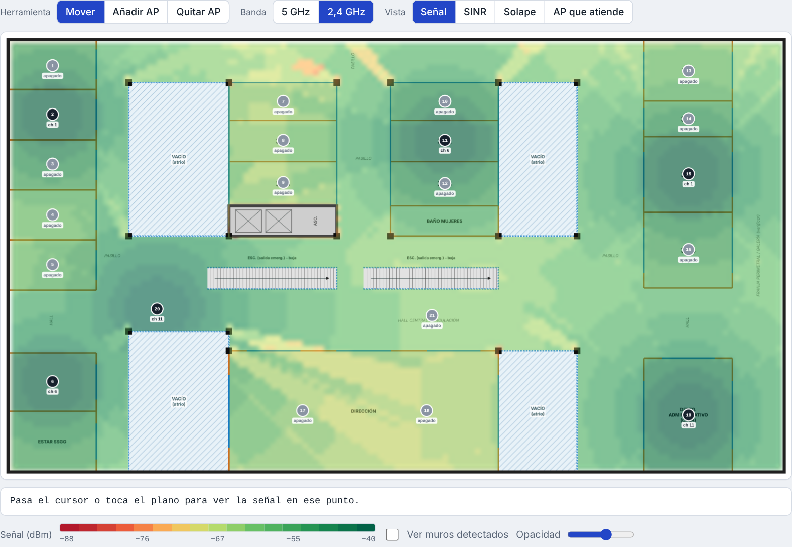
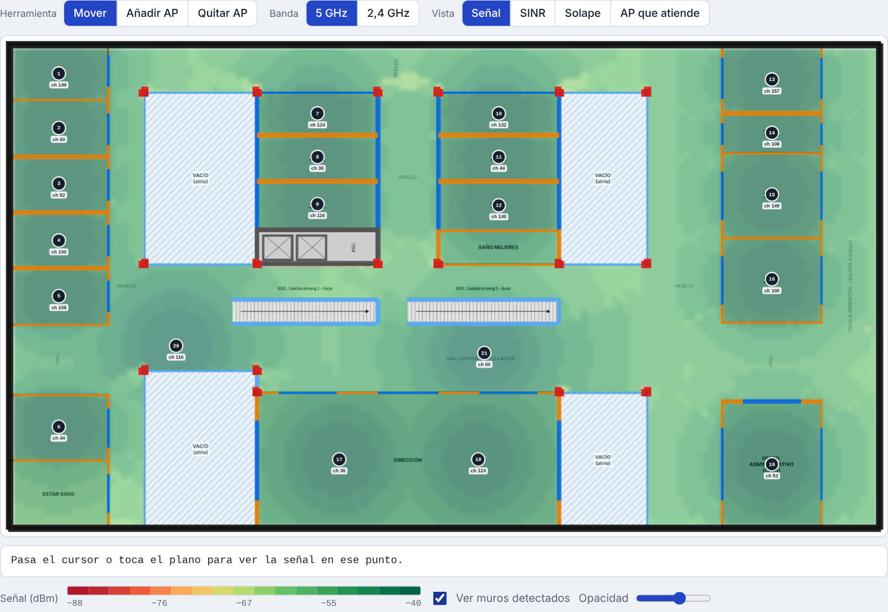

# Metodología del site survey

Site survey **predictivo** de los pisos 3, 4 y 5 de Duoc UC sede Viña del Mar, hecho para el proyecto semestral de TRY1101 Tecnología de Redes Inalámbricas (Fase 2: red WiFi).

## 1. Objetivo

Dar cobertura WiFi a los tres pisos con calidad suficiente para voz y video en salas, oficinas y pasillos:

| Criterio | Meta |
|---|---|
| Señal en el área útil | ≥ −67 dBm en al menos el 99 % del área (voz y video) |
| Roaming | 2 o más APs con ≥ −67 dBm en la mayor parte del área |
| Calidad (SINR) | ≥ 25 dB |
| Banda principal | 5 GHz; 2,4 GHz solo de apoyo para equipos antiguos |

## 2. Alcance y supuestos

- Los pisos 3, 4 y 5 tienen la **misma planta**, así que se modela una planta tipo y se repite el diseño en cada piso.
- 21 APs **Huawei AirEngine 5761-11** por piso (63 en total), conectados a 2 switches Cisco Catalyst 9200L 24P PoE+ por piso.
- APs montados en el cielo a 3,0 m. Usuario de referencia con el equipo a 1,2 m.
- Los vacíos del atrio, las escaleras y el núcleo de ascensores no cuentan como área útil. El baño queda fuera del cálculo por defecto (se puede incluir).

## 3. Pasos

1. **Plano a escala.** Se recortó la planta tipo y se dejó en escala fija de 30 px = 1 m (73,3 m × 41,3 m).
2. **Muros y materiales.** Los muros se pasaron a una grilla de 0,2 m (367 × 207 celdas), y cada celda guarda un material. Se eligieron valores típicos de atenuación:

   | Material | 2,4 GHz | 5 GHz |
   |---|---|---|
   | Muro exterior de hormigón | 15 dB | 20 dB |
   | Núcleo de ascensores | 18 dB | 25 dB |
   | Columna de hormigón | 15 dB | 20 dB |
   | Tabique metalcon | 3 dB | 5 dB |
   | Vidrio de sala | 2 dB | 4 dB |
   | Baranda de vidrio | 1 dB | 2 dB |

3. **Salas y zonas.** Se marcó cada sala (311–316, 321–323, 331–333, 341–344, Dirección, Depto. Administrativo, Estar SSGG, baño, pasillos y hall) para poder sacar resultados por sala.
4. **Ubicación de APs.** Se puso un AP por sala de clases, dos en Dirección, uno en el Depto. Administrativo y dos en el hall central. Así cada sala tiene su AP y los pasillos quedan cubiertos por solape.
5. **Potencia.** 5 GHz a 17 dBm y 2,4 GHz a 11 dBm. Son valores bajos a propósito, porque en alta densidad conviene celdas chicas y menos interferencia entre APs.
6. **2,4 GHz reducida.** Solo 6 de los 21 APs por piso tienen la radio de 2,4 GHz encendida. Con 3 canales sin solape (1, 6, 11), encender las 21 radios solo agrega interferencia.
7. **Canales.** La asignación automática reparte los canales de 5 GHz de 40 MHz según la interferencia que hay entre cada par de APs. Además rota el plan en cada piso para que un AP del piso 3 no quede en el mismo canal que el AP de arriba en el piso 4.
8. **Cálculo y revisión.** Se revisan los mapas de señal, SINR, solape y AP que atiende, junto con la tabla por sala. Luego se ajusta hasta cumplir los criterios.

## 4. Modelo de propagación

Para cada AP y cada celda de 0,5 m del plano:

```
Señal (dBm) = Ptx + G_antena − FSPL(1 m) − 10·n·log10(d) − Σ pérdidas de muros cruzados
```

| Parámetro | Valor | Origen |
|---|---|---|
| Ptx | 17 dBm (5 GHz) / 11 dBm (2,4 GHz) | Diseño (máx. del equipo 27 dBm combinado) |
| G_antena | 3 dBi (5 GHz) / 2 dBi (2,4 GHz) | Ganancia combinada, ficha Huawei |
| FSPL a 1 m | 47,0 dB (5 GHz) / 40,2 dB (2,4 GHz) | Espacio libre |
| n | 2,2 | Exponente de pérdida para oficinas abiertas |
| d | Distancia 3D (incluye la altura AP − usuario) | — |
| Piso de ruido | −95 dBm en 20 MHz (+3 dB por cada duplicación del ancho) | Supuesto |

Los muros que cruza la línea entre el AP y cada punto se cuentan con un trazado de rayos sobre la grilla (algoritmo DDA). Cada muro distinto se cuenta una sola vez.

**SINR** = señal del mejor AP − 10·log10(ruido + suma de la señal de los otros APs **en el mismo canal**).

## 5. Resultados (diseño sugerido, cada piso)

| Indicador | 5 GHz | 2,4 GHz |
|---|---|---|
| Área con ≥ −67 dBm | **99,9 %** | 99,6 % |
| Señal más baja en el área útil | −74 dBm | −74 dBm |
| Área con 2 o más APs (roaming) | 98,2 % | 87,9 % |
| Área con SINR ≥ 25 dB | 98,9 % | 63,4 % |
| APs con radio activa | 21 | 6 |

Los tres pisos dan los mismos números porque la planta es la misma. Lo único que cambia es el plan de canales.

Todas las salas de clases quedan con el 100 % de su área sobre −67 dBm en 5 GHz. El punto más bajo (−74 dBm) está en un rincón de pasillo, no en una sala.

El SINR de 2,4 GHz es más bajo porque esa banda tiene solo 3 canales y es la de apoyo. Por eso los usuarios se llevan a 5 GHz (band steering).

## 6. Capturas

| | |
|---|---|
|  Señal 5 GHz, piso 3 |  SINR 5 GHz |
|  Solape (cuántos APs ≥ −67 dBm) |  AP que atiende cada punto |
|  Señal 2,4 GHz (6 radios) |  Muros detectados por material |

Otras vistas: [vista general](capturas/01_vista_general.png), [piso 4](capturas/08_piso4.png), [indicadores](capturas/09_indicadores.png), [cobertura por sala](capturas/10_cobertura_por_sala.png) y [edición de un AP](capturas/11_ap_seleccionado.png).

## 7. Limitaciones y validación

- Es una **predicción**. Los valores de atenuación son típicos, no medidos en el edificio.
- No calcula la interferencia entre pisos. Esa se reduce rotando los canales de cada piso.
- No modela reflexiones ni el efecto de las personas en la sala, que con la sala llena puede restar entre 3 y 6 dB.
- Después de instalar se debe hacer un **site survey pasivo** (por ejemplo con NetSpot o Ekahau) para confirmar la señal y el SINR, y ajustar potencia y canales desde la controladora Huawei.
